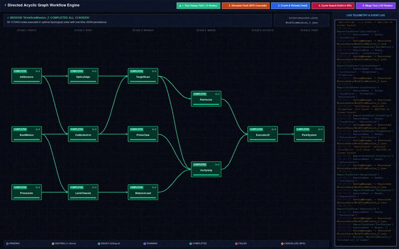
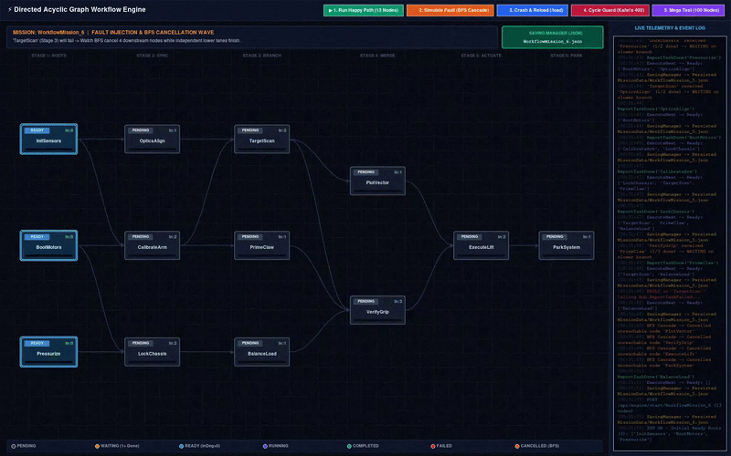
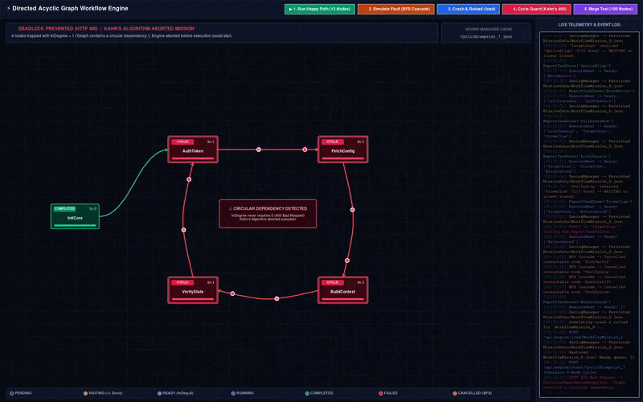
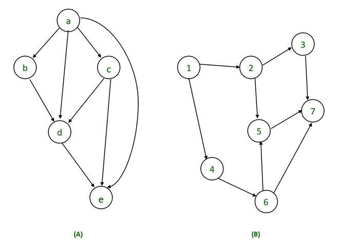

# Directed Acyclic Graph Workflow Engine

> *Come and see what shall be shown,*  
> *From tears and joy fully grown,*  
> *Its true purpose yet unknown,*  
> *Forged by a hand of my own.*
>  
> *Look down to find what’s below,*  
> *Hidden where no light could go.*  
> *Weigh this project now with care;*  
> *Keep your verdict true and fair.*  

# What is it

## Overview
What is being presented before thine eyes is an API-controlled Workflow Engine for a given set of tasks (mission) sorted and prepared by a DAG.

<p align="center">
  
  <br />
  <em>The animation above demonstrates **successful** execution.</em>
</p>

<p align="center">
  
  <br />
  <em>The animation above demonstrates **failed** execution.</em>
</p>

<p align="center">
  
  <br />
  <em>The animation above demonstrates **cyclical** execution.</em>
</p>

### How does it work (In simple terms)
The whole project, except the frontend, is made in C#, and the order of functionality could be explained like this:
1. **Setup:** Initializes the mission by receiving a blueprint payload of tasks (nodes) and their dependencies via a POST request to the REST API (`/api/engine/start/{missionId}`), or resumes an interrupted one via `/api/engine/load/{missionId}`.
2. **Validation & DAG (Kahn's Algorithm):** The Engine calculates dependencies across the blueprint. It maps them (`InDegree`) for every task. If it finds a circular dependency, it aborts with a `400 Bad Request`. Otherwise, tasks with 0 dependencies are queued as `Ready`.
3. **Execution Loop (WebSockets):** A state machine tracks tasks dynamically (`Pending`, `Ready`, `Running`, `Completed`, `Failed`, `Cancelled`) — updated by the frontend through SignalR (`ReportTaskDone` / `ReportTaskFailed`). When a task succeeds via the WebSocket, the engine subtracts dependencies from its neighbors. If a neighbor reaches 0 dependencies, it is instantly pushed back to the client via SignalR (`ExecuteNext`).
4. **Simulation / Showcase:** A `main.py` file located in the `TestSimulation` folder acts as a simulated client to run and visualize the entire process.  
   *Note: If someone wants to use this engine in reality, they have to make the frontend/client themselves; that Python file is purely a showcase.*

### Usage
This project has endless potential, as it can be implemented and used at any stage of another project to many extents.  
What lies below is just to present a rough idea — it by far does not contain all possible use cases:
- **Robotics & Hardware Orchestration:** Sequencing physical machine operations (e.g., *Calibrate Sensors --> Move Arm --> Actuate Gripper*) where independent tasks can run in parallel, and a hardware fault in one node immediately cascades to safely cancel downstream movements.
- **Custom CI/CD & Build Pipelines:** Compiling independent modules concurrently and only triggering packaging or deployment nodes once all prerequisite suites report `Completed`.
- **Game Development (Tech Trees, Crafting, or Quest Systems):** Tracking complex progression or automation chains where completing prerequisite nodes dynamically unlocks new branches in real time.
- **Distributed Data & ETL Pipelines:** Fetching and transforming data from multiple sources simultaneously, waiting for parallel streams to finish (`InDegree == 0`), and merging them into a final operation.

<details>
<summary><h2>Deep Explanation (Click to expand)</h2></summary>

What lies here is a combination of two very distinguished concepts:

### Directed Acyclic Graph
First and foremost is the Directed Acyclic Graph — often abbreviated as DAG.

> [!NOTE]
> **Definition (DAG):** A directed graph that contains no directed cycles.

<p align="center">
  
  <br />
  <em>The graph above represents a Directed Acyclic Graph (DAG).</em>
</p>

#### But what does it actually represent here?
The DAG is the map of the corresponding workflow of the assigned mission. 
- **Nodes (dots)** are the **Tasks** — specific commands or actions that are to be executed. 
- **Direction lines (arrows)** are the **Dependencies** — tasks that must be finished before the next one can be executed.

When a client initializes a mission, it sends a JSON blueprint formatted like this (`BlueprintNode`):
```json
[
  { "id": "CalibrateSensors", "dependencies": [] },
  { "id": "MoveArm", "dependencies": ["CalibrateSensors"] },
  { "id": "CloseGripper", "dependencies": ["MoveArm"] }
]
```

In order to create and validate the graph, the system uses the following algorithm:
- **Kahn's Algorithm (Topological Sorting):** 
  1. It tracks dependencies (`InDegree`) from the initial blueprint to create the graph. 
  2. If a circular dependency is detected (cycle), it immediately throws a `CircularDependencyException`, preventing deadlocks before execution even begins.

> [!TIP]
> Discover more at: [Directed Acyclic Graph Explained.](https://en.wikipedia.org/wiki/Directed_acyclic_graph)

___

### Workflow Engine
The second half, yet equally important, is the manipulation of the DAG data itself.

This half could be divided into 3 layers.
Each represents a vital role in maintaining workflow and balance. One can work alone, but will never be fulfilled without the others.

In operational order they are as follows:

#### REST API & WebSockets
The skin of this half is the API — located in the `ConsistencyEngine.Api` folder.
- **REST API (`EngineController`):** Initial blueprint payloads (with automatic `[Required]` model validation) and mission recovery requests (`/start/{missionId}` and `/load/{missionId}`) are sent through here.
- **SignalR WebSocket (`EngineHub`):** Task completions and failures are reported here, and any newly unlocked commands (`ExecuteNext`) are pushed directly to the frontend — without waiting to be asked for them.

#### Manipulation of the Data
The brain is located in `ConsistencyEngine.Core`.

It does a simple yet important job: it takes the commands from the frontend, validates them, creates a DAG from them, and afterwards executes it and returns the next command. 
Under the hood, this involves:
- **Directed Acyclic Graph (DAG):** A graph created from the task (`ConsistencyGraph`) that contains all nodes and dependencies necessary for execution. Further explained in the **Directed Acyclic Graph** section above.
- **State Machine:** It manages a strict state machine (`NodeStatus`) to track the exact lifecycle of every task — whether it is `Pending`, `Ready`, `Running`, `Completed`, `Failed`, or `Cancelled`.
- **Live Execution (DAG):** On a node update from the logic above, `TaskOrchestrator` updates the whole graph based on the state and the dependencies of the updated node.
- **Breadth-First Search (BFS):** If a task fails, a queue traversal is used to cascade the failure through the graph, instantly finding and canceling all unreachable downstream nodes.
- **Monitor (Thread) Locks:** Real-time thread-safe concurrency (`_stateLock`) ensures that if multiple clients report task completions simultaneously, the graph state is safely updated and never corrupted.
- **Multi-Mission Possibility:** Thanks to `MissionManager.cs`, the Brain isn't limited to a single workflow. It can spin up, track, and manage multiple distinct missions simultaneously in completely isolated orchestrators without them ever interfering with each other.

#### Saving System
The backbone of any system is saving — located inside of `SavingManager.cs`. 
This part ensures that when a server crashes, the entire Graph with its progress is saved. It snapshots the DAG into JSON format upon every single state change, allowing the engine to reload complex missions via `/api/engine/load/{missionId}` and recalculate `InDegree` counts around already-completed tasks so execution resumes exactly where it was interrupted.

___
...and its purpose is to execute a given mission in the most suitable and fastest order based on the frontend behavior and to prevent any illogical errors in commands — for robots or any software with the need of proper execution. It can also be used to locate any cyclic mistakes in a given task (timeline execution order).

## Additional Info
- **Tests:** This project was implemented using the Test-Driven Development (TDD) method, meaning every piece of backend logic (except the API) is verified by individual unit tests located inside the `ConsistencyEngine.Tests` folder.

</details>

___

<details>
<summary><h2>Running and Editing Explanation (Click to expand)</h2></summary>

### How to Run It
To use this given software, it must firstly be brought to life. This can be achieved by following these steps:

**Primo**
Clone the repository onto your machine of choice:
```bash
git clone https://github.com/Korgie8/ConsistencyEngine.git
cd ConsistencyEngine
```

**Secundo**
The engine requires the .NET 8.0 SDK (or newer). To run the test showcase, you will also need Python installed on your machine.

Restore the required NuGet dependencies across the solution:
```bash
dotnet restore
```

*(Optional)* If you wish to verify the integrity of the core logic first, run the unit test suite:
```bash
dotnet test
```

**Tertio**
Save your breath; one last step is still ahead of us:

Open a terminal in the root folder and start the C# engine by targeting the API project:
```bash
dotnet run --project ConsistencyEngine.Api
```
*(This automatically compiles the binaries, mounts the REST API, and opens the SignalR WebSocket hub).*

___

### How to control it
Once the C# engine is in motion, you need a client to interact with it. Open a **second terminal window**, navigate to the showcase folder, and run the Python script:

```bash
cd TestSimulation
python main.py
```
This script acts as the frontend, pushing a mock graph to the engine and showing the execution in real time in the UI.

___

### Wanna change the behavior?
You can tweak the core behavior directly inside the source code:

- **Saving Location (`SavingManager.cs`):** Change the `_folderPath` string if you want to alter where the JSON progression graphs are dumped (defaults to the `MissionData` folder).
- **Showcase Graph (`main.py`):** Edit the Python file to construct different `BlueprintNode` payloads to test how the engine handles branching paths or forced task failures.

</details>

___

## Built With
- **C# / .NET 8.0**
- **ASP.NET Core & SignalR** (REST API & WebSocket)
- **Tests — TDD (xUnit & FluentAssertions)**
- **Python** (Test simulation visualizer)

## My thoughts

Keeping this project within the bounds of my actual skill at the time of making required a few deliberate trade-offs to be put in place.

### Durability vs. I/O Throughput
To guarantee mission survival when the server crashes without the massive overhead of an external database, the engine snapshots the entire graph into a local JSON file upon every state change. Luckily, as this disk write happens inside the orchestrator's thread lock (`_stateLock`), absolute data integrity is guaranteed, and race conditions are prevented. However, it is not all sunshine and rainbows; the cost of this safety is an I/O bottleneck. On massive graphs with hundreds of parallel nodes completing simultaneously, threads will queue up waiting for that very disk-saving operation to finish.

### Client-Driven Recovery vs Autonomous Server Healing

While the server diligently handles graph saving to the disk, it does not automatically recover interrupted missions upon reboot. Instead, the backend waits in a blank state until the client explicitly calls the `/load/{missionId}` API endpoint to get back on track.

This decision made the backend significantly simpler, but it shifted the responsibility of crash-recovery coordination entirely onto the client. Luckily, sends already has a built-in solution via automatic time-based pinging of the frontend.

### Future Roadmap

If I were to continue developing this project, I would definitely start with those points:
- **Asynchronous Persistence:** Replacing synchronous full-graph JSON dumps with an asynchronous database (such as PostgreSQL) or an append-only event log outside the critical thread lock.
- **`Running` Node Status:** Utilizing the `Running` node status to track when a client has claimed a task, to safely automatically retry or fail tasks or to provide more information.
- **Multi-Client Synchronization:** Upgrading the SignalR hub to use mission-specific group broadcasting instead of 1-to-1 client replies. This involves updating the backend logic — specifically handling client connections, joins, and disconnects — to adapt the engine for multi-client workflow.

## Acknowledgements
All algorithms and logic inside `ConsistencyEngine.Core`, tests inside `ConsistencyEngine.Tests`, and the API inside `ConsistencyEngine.Api` were implemented by hand. In contrast, the simulation layer (`main.py` located in the `TestSimulation` folder) used to showcase the project was generated entirely by AI.
